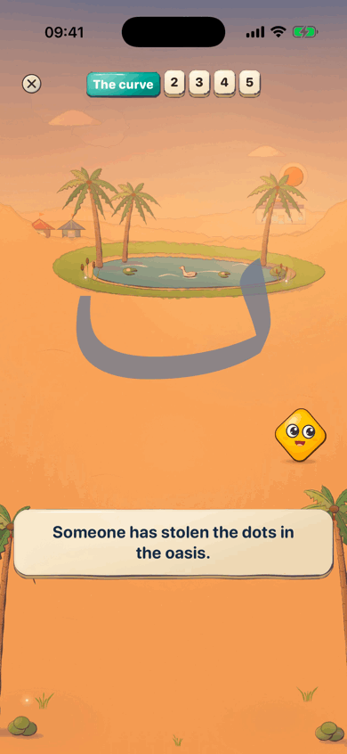
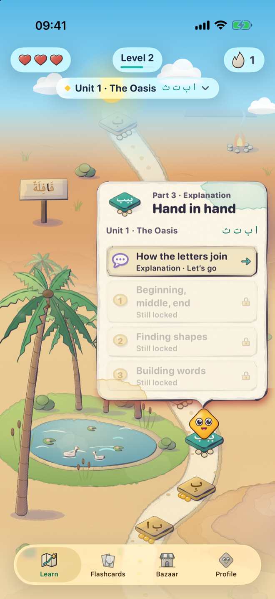
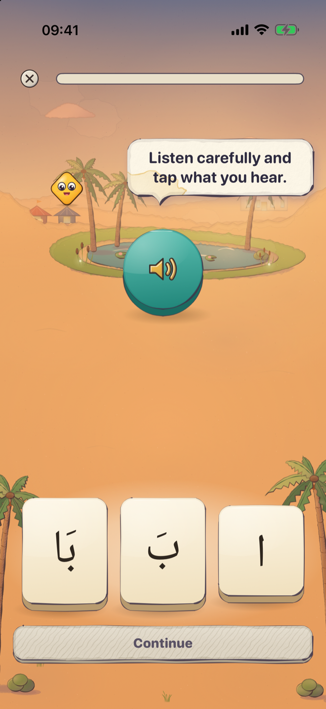
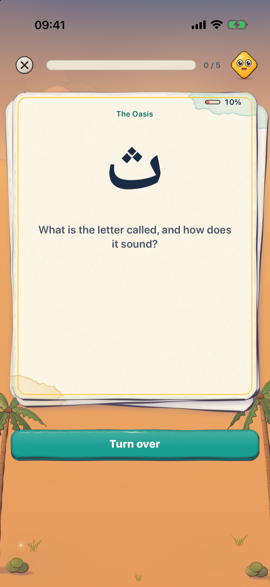
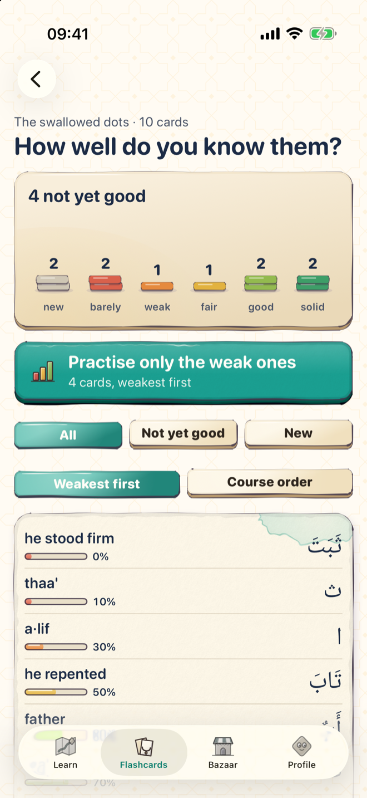
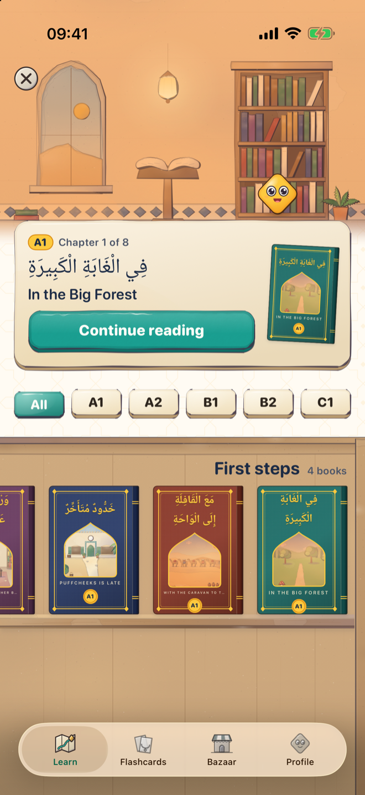
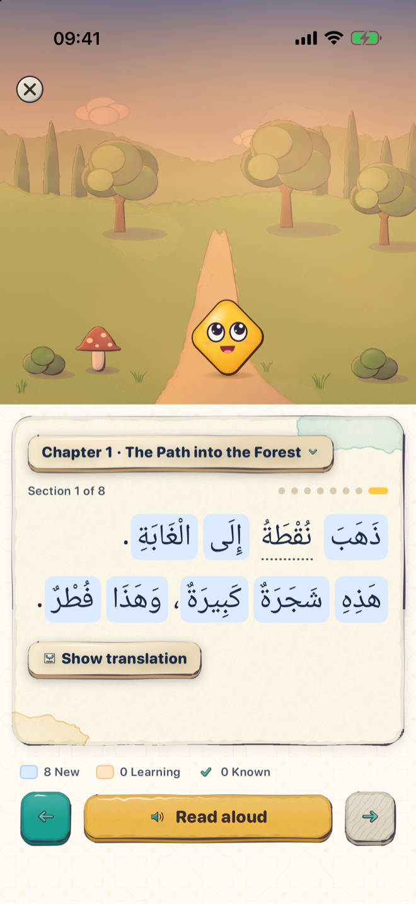
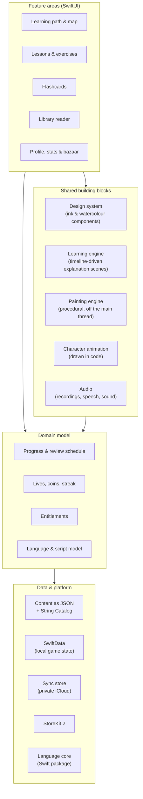

# Kalino

**An iPhone app for learning languages, from the first letter to reading real texts, inside a hand-painted, animated world. Arabic, German and English, each learnable from any of the three.**

Most language apps start with words and skip the foundation: the alphabet and how to actually read. For a script like Arabic this is the first wall: letters change shape depending on their position and short vowels are tiny marks above and below the line. Kalino starts exactly there, in every course. Every new idea is introduced as a short animated scene, practised in small, varied exercises and brought back at the right time, so reading becomes something you can actually do rather than something you memorise. The whole app is drawn in its own ink-and-watercolour style and led by a small golden character called Nuqta.

> Status: in TestFlight · App Store release planned · iOS 18+, iPhone (portrait)

---

## Features

- **Three languages, nine courses.** Arabic, German and English, both as the language you learn and as the language you learn from, so every one of the three can be learned from every one of the three.
- **Learn to read from zero.** Letters, sounds and pronunciation, and for Arabic also joining forms and vowel marks, each introduced by a narrated, animated explanation before it is practised.
- **A learning path on a painted map.** Lessons live in places on an illustrated map; checkpoints make sure a topic has really settled before the path moves on.
- **Varied, playful exercises.** Listening, recognising, reading and sorting tasks with immediate, friendly feedback. Every task reads its question aloud.
- **Listen and repeat.** Learners can record themselves and hear their voice right next to the model pronunciation. The recording never leaves the device.
- **Flashcards with spaced repetition.** Cards come back at increasing intervals that learners can adjust themselves.
- **The Library** *(in development)*. Graded picture-book stories from beginner to advanced. Tapping a word opens a sheet with its meaning, pronunciation and word family, and turns unknown words into flashcards in one tap.
- **Motivation without manipulation.** Levels, a daily streak, a weekly overview and statistics based on real practice time. Coins are earned only by learning and are never sold; there are no loot boxes and nothing random to buy.
- **Family-friendly.** The app asks once whether an adult or a child is learning; in child mode there are no purchase prompts.
- **Accessible.** VoiceOver labels for everything tappable, Reduce Motion support, larger text sizes, layouts from the smallest to the largest current iPhones, and a right-to-left-ready interface.
- **Ready for more languages.** Content is data, so a new language pair is new content, not new code.
- **Optional subscription.** Extras such as unlimited lives; the core path stays fully learnable without it.

## Screenshots

Current TestFlight build, English interface, course "Arabic for English speakers".

  
  
  
  

<em>Animated explanation · Learning path · Exercise · Flashcards</em>

  
  
  

<em>Card progress · The Library · Reader</em>

## Architecture

Kalino is a single SwiftUI app with a clear split between feature areas, shared engines, the domain model and content. All data stays on the device or in the user's private iCloud; there is no backend.

More on the main building blocks and the reasoning behind them: **[docs/architecture.md](docs/architecture.md)**.

## Tech stack

| Area | Technology |
|---|---|
| Language & UI | Swift, SwiftUI (iOS 18+), Swift concurrency |
| Persistence | SwiftData with versioned schemas and safe migrations |
| Sync | SwiftData + CloudKit (user's private database), separate from the local game state |
| Purchases | StoreKit 2, fully on-device, no server |
| Arabic text | Core Text for shaping and measuring, so vowel marks are never clipped |
| Graphics | Procedural painting with Core Graphics and SwiftUI Canvas; characters and world drawn in code, no image assets |
| Audio | AVFoundation for narration, listen-and-repeat and synthesised sound effects; system speech as fallback |
| Content | JSON per language and course, Apple String Catalog for the interface |
| Shared logic | A local Swift package for language processing, content validation and learning simulation, testable on the Mac without UI |
| Testing | Swift Testing and XCTest (≈1,500 logic tests), XCUITest (≈140 UI tests), image fingerprints, on-device frame-time measurements |
| Distribution | TestFlight |

## Privacy

Kalino collects no personal data.

- **No account, no analytics, no tracking, no ads, no own server.**
- **Learning progress stays on the iPhone.** If the user is signed in to iCloud, a copy is kept in their *private* iCloud database so progress survives a new device or reinstall. I never see it.
- **Microphone (optional):** recordings for "listen and repeat" stay on the device and are deleted after playback.
- **Purchases** run entirely through Apple's App Store; the app only learns whether a subscription is active.
- The app ships a privacy manifest that declares no tracking and no collected data types.

Privacy policy: <https://mosaik114.github.io/loratu-rechtliches/>

## How it's built

Kalino is built AI-native with Claude Code. My role is closer to a tech lead than a typist: I read and adjust code, but mainly I own the scope, the product and architecture decisions and the quality bar, and I can explain why each part is built the way it is. The agents make me faster; they don't make the decisions.

In practice that means:

- **Work in small, reviewable stages.** Each stage runs on its own branch, is reviewed (diff, tests, before/after screenshots) and only then merged.
- **Fix causes, not symptoms.** A bug is closed when the root cause is named and the fix is confirmed on a real device.
- **Quality gates in the codebase.** Structure tests enforce architecture rules such as single ownership of shared state and file size limits; a full logic test run happens before every device build.
- **Measured, not guessed.** Animation smoothness is measured on the iPhone (120 Hz) and compared against a budget; memory is planned for smaller devices.

## Status & roadmap

| Version | Focus | Status |
|---|---|---|
| — | Internal builds | ✅ Running on TestFlight |
| 1.0 | Learn to read: the alphabet courses | 🔄 Polishing for App Store release |
| 2.0 | Reading & review: the Library and flashcards | 🔄 In development |
| 3.0 | Quran section in the Arabic course | Planned |
| Later | More languages | Planned |

## Contact

Mazgin Abdulwahed Ahmad · [mazgin.ahmad@outlook.com](mailto:mazgin.ahmad@outlook.com)

## License

© 2026 Mazgin Abdulwahed Ahmad. **All rights reserved.**

Source code is private; this repository documents the product and its engineering. No part of this repository may be copied, modified or redistributed without written permission.
