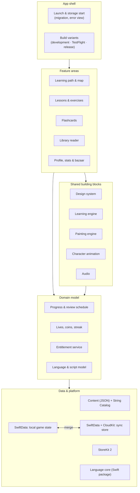

# Kalino – Architecture overview

This page describes the main building blocks of Kalino and why they are built the way they are. It stays at the level of modules and decisions; the source code itself is private.

## Layers

Folders are organised by purpose. Code that two areas need becomes a shared building block instead of a copy, and shared code never lives inside a single feature's folder.

## Building blocks and the reasons behind them

### Content is data, not code
All learning content lives in JSON files, organised by the language being learned and by course; all interface text lives in Apple's String Catalog. The general building blocks (lessons, exercises, vocabulary, cards, reader) make no assumption about a specific language pair. Script, writing direction and fonts come from a language model rather than being hard-coded.

*Why:* Arabic, German and English are planned both as the language you learn and as the language you learn from. Adding a pair should mean adding content, not touching code.

### A shared vocabulary
Every word exists once, with its parts, its root, its learning state and the sentences it appeared in. Lessons, the library and flashcards all read from and write to the same vocabulary.

*Why:* Knowing a word in one part of the app should count everywhere, and Arabic words carry attached prefixes and suffixes that need to resolve to the same base word.

### Learning engine: explanations as timelines
Animated explanations are described as data: a sequence of beats with pictures, moving words and narration. A single timeline clock drives picture, motion and voice together.

*Why:* One owner of time means narration and animation can't drift apart, tapping mid-animation never causes a jump, and new explanations are written as content instead of new view code.

### Everything is drawn in code
Characters, the world map and the watercolour surfaces are painted procedurally, without image assets and without third-party animation runtimes.

*Why:* One consistent hand-made style, resolution independence on every iPhone, art that follows light and dark appearance, and a small app bundle.

### Painting engine off the main thread
Painted images are requested by the screen that needs them, prioritised (what the user sees first is painted first), produced off the main thread and cached. A memory budget per device class keeps smaller iPhones safe.

*Why:* The interface runs at 120 Hz. Painting is expensive, so it must never block scrolling or animation.

### Persistence that never loses progress
The local game state lives in SwiftData with versioned schemas and safe migrations. If the store cannot be opened, the app shows a calm error view with "Try again" instead of continuing with an empty state, and it never deletes or overwrites the file.

*Why:* A learner's progress is the most valuable thing in the app.

### iCloud sync through a separate store
Sync does not mirror the game state directly. Each device writes compact, versioned and checksummed snapshots of its state into a small, separate store that SwiftData syncs with the user's private CloudKit database; devices merge what they read.

*Why:* Signing out of iCloud or switching accounts can at most clear the sync store, never the progress. And because a published CloudKit schema can only be extended, the schema is deliberately tiny and generic; everything that may change lives inside the versioned payload.

### Purchases without a server
StoreKit 2 runs entirely on the device. At launch the app reads verified entitlements and keeps observing changes; every screen asks one shared entitlement service. Pending or cancelled purchases unlock nothing; a billing grace period counts as active.

*Why:* No backend to run or secure, and one source of truth for "what is unlocked".

### Audio
Narration is recorded with a human voice; where a recording is missing, the system voice reads instead, so the app is never silent. Sound effects are synthesised in the app. Listen-and-repeat recordings stay on the device.

### Build variants
Development, TestFlight and release builds differ through one configuration type rather than compile flags scattered through the code.

*Why:* Every difference between variants is visible in one place.

### Accessibility and layout
Every screen supports VoiceOver, Reduce Motion and larger text sizes, and is checked across the full range of current iPhone widths. The interface is prepared to run mirrored for right-to-left languages.

## Quality and testing

| Layer | What it covers |
|---|---|
| Logic tests (≈1,500, Swift Testing and XCTest) | Rules and calculations: review scheduling, lives and streaks, content validation, sync merge, entitlements, launch options |
| Structure tests | Architecture rules: single ownership of shared state, file size limits, no duplicated building blocks |
| UI tests (≈140, XCUITest) | The important user journeys and what is only visible in the running app |
| Image fingerprints | Painted images stay pixel-identical unless a change is intended |
| Language core package | Text normalisation, typing evaluation and learning simulations, running headless on the Mac in seconds |
| On-device measurement | Frame times while scrolling and animating on a real iPhone, compared against a budget |

---

© 2026 Mazgin Abdulwahed Ahmad. All rights reserved. Source code is private; this repository documents the product and its engineering.
